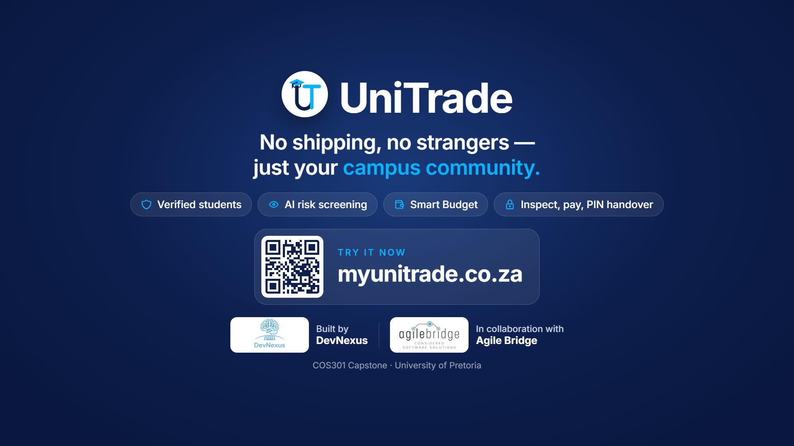
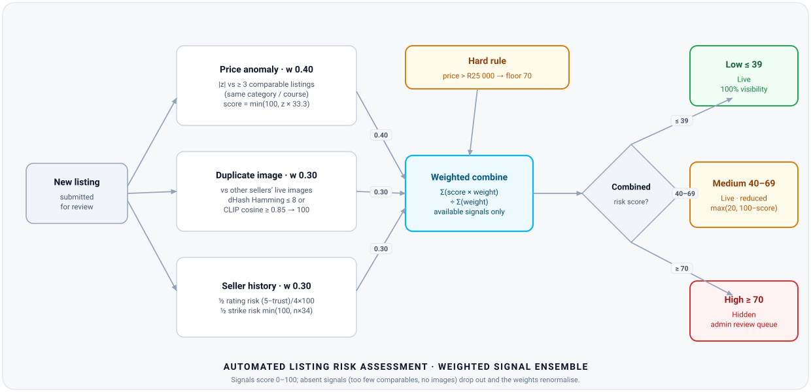
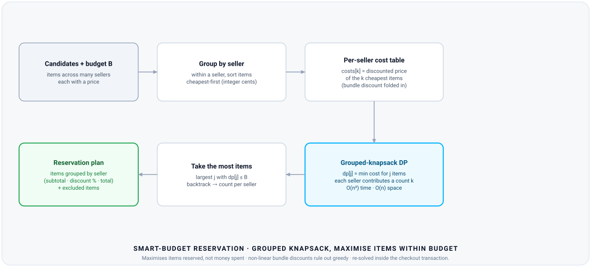
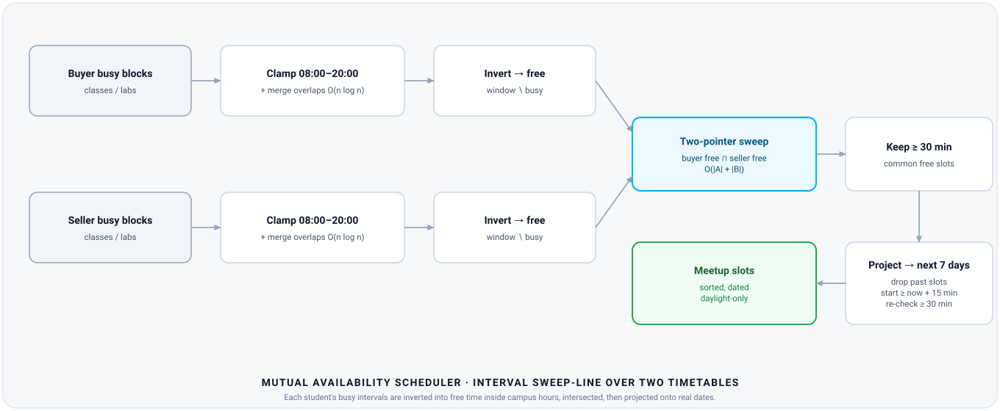
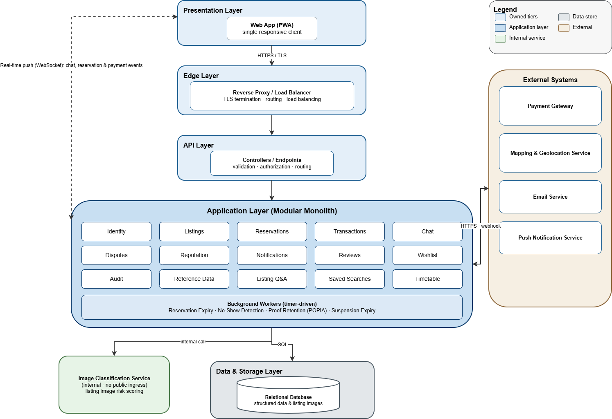

<div align="center">


# UniTrade

### The trusted peer-to-peer marketplace for South African university students

<sub><em>Built by DevNexus · University of Pretoria · COS301 Capstone 2026 · In collaboration with Agile Bridge</em></sub>

<br/>

<!-- Primary calls to action -->
<a href="https://myunitrade.co.za"></a>
<!-- TODO: paste the demo video URL --><a href="TODO_DEMO_VIDEO_URL"></a>
<a href="https://youtu.be/Hr4_pNWIA4Q"></a>
<a href="https://github.com/orgs/COS301-SE-2026/projects/37"></a>

<br/>
<sub><b>Demo account</b> (no sign-up needed): <!-- TODO: fill credentials --><code>TODO_EMAIL</code> / <code>TODO_PASSWORD</code></sub>

<br/><br/>

<!-- Quick nav -->
<a href="#key-features"><b>Features</b></a> &nbsp;·&nbsp; <a href="#under-the-hood"><b>Under the hood</b></a> &nbsp;·&nbsp; <a href="#architecture"><b>Architecture</b></a> &nbsp;·&nbsp; <a href="#documentation"><b>Docs</b></a> &nbsp;·&nbsp; <a href="#team--devnexus"><b>Team</b></a>

<br/><br/>

<!-- Build status -->
[](https://github.com/COS301-SE-2026/UniTrade/actions/workflows/backend-ci.yml)
[](https://github.com/COS301-SE-2026/UniTrade/actions/workflows/web-ci.yml)
[](https://github.com/COS301-SE-2026/UniTrade/actions/workflows/cd.yml)
[](https://github.com/COS301-SE-2026/UniTrade/actions/workflows/e2e.yml)
[](https://codecov.io/gh/COS301-SE-2026/UniTrade)
[](https://stats.uptimerobot.com/)
[](https://github.com/COS301-SE-2026/UniTrade/issues)

</div>

<div align="center">
<a href="https://youtu.be/Hr4_pNWIA4Q"></a>

<sub><b>Watch the trailer</b> · <a href="https://youtu.be/Hr4_pNWIA4Q">YouTube</a> · <a href="https://myunitrade.co.za">live app</a></sub>
</div>

---

## The problem

University students in South Africa face serious financial pressure: high tuition fees, rising living costs and expensive prescribed textbooks. The alternatives are poor — students either buy new materials at full price, or rely on informal peer networks (WhatsApp groups, notice boards) that are unverified, unreliable and often unsafe. There is no structured, trusted platform where students can safely exchange academic materials with confidence.

## What UniTrade does

UniTrade is a verified marketplace where students list, browse and buy second-hand academic materials from peers at their own institution. Every user is verified as a currently enrolled student before they can trade, every handover happens on campus in daylight, and payment is held until the buyer confirms the handover in person.

## Key features

| Feature | Description |
| --- | --- |
| **Student verification** | University email + OTP, then a human-reviewed proof of registration before trading is unlocked |
| **AI listing screening** | A self-hosted CLIP model, perceptual image hashing and price-anomaly detection score every new listing for fraud risk before it goes live |
| **Smart Budget** | Finds the most items you can afford across multiple sellers, applying each seller's bundle discounts |
| **Timetable-aware meetups** | Intersects buyer and seller timetables to suggest mutually free, daylight-only campus slots |
| **Escrow payments & handover PIN** | PayFast payment is held and released only when the buyer enters the seller's one-time PIN at the meetup |
| **GPS check-in** | Geofenced meetup check-in feeds automatic no-show detection and dispute handling |
| **Real-time chat & alerts** | SignalR chat, saved-search alerts, FCM push notifications and email via Azure Communication Services |
| **Reputation & sanctions** | Reviews unlock only after a completed trade, and strikes escalate automatically to temporary and permanent bans |

---

## Under the hood

Three of the problems we found most interesting to solve. Each diagram is generated from the real implementation — the thresholds, weights and complexities match the code.

### Automated listing risk assessment

Every new listing is scored **0–100** by a weighted ensemble — a price-anomaly *z*-score against comparable listings, duplicate-image detection (perceptual dHash + CLIP embeddings) and seller history — then routed to full visibility, reduced visibility, or the admin review queue. Signals with too little data drop out and the weights renormalise.

<div align="center">

</div>

<sub><a href="src/backend/Modules/Listings/Risk/ListingRiskScoreService.cs"><code>ListingRiskScoreService.cs</code></a></sub>

### Smart-budget reservation

Given a budget and items spread across many sellers, a **grouped-knapsack** dynamic program maximises the *number* of items you can reserve — folding each seller's bundle discount into a per-count cost table, computed in integer cents and re-solved inside the checkout transaction.

<div align="center">

</div>

<sub><a href="src/backend/Modules/Reservations/BundleKnapsack.cs"><code>BundleKnapsack.cs</code></a></sub>

### Mutual availability scheduler

Buyer and seller timetables are inverted into free time within campus hours, intersected with a **two-pointer sweep line**, filtered to slots of at least 30 minutes, and projected onto the next seven days as concrete, daylight-only meetup times.

<div align="center">

</div>

<sub><a href="src/backend/Modules/Timetable/AvailabilityCalculator.cs"><code>AvailabilityCalculator.cs</code></a></sub>

---

## Architecture

<div align="center">

</div>

UniTrade is a **modular monolith**: a single .NET 10 API split into isolated domain modules (Identity, Listings, Reservations, Transactions, Chat, Disputes, Reputation, Timetable and more) under `src/backend/Modules`. This gives ACID transactions across domains — reserving a listing, starting its timer and opening a chat in one transaction — without the coordination cost of microservices. A separate Python service runs the CLIP image model on an internal-only network.

<div align="center">

### Tech stack

**Frontend**<br/>


**Backend**<br/>


**AI service**<br/>


**Cloud & DevOps**<br/>


</div>

| Layer | Technology |
| --- | --- |
| Frontend | React 19, TypeScript, Vite (PWA), Tailwind CSS, Leaflet / OpenStreetMap |
| Backend | .NET 10 ASP.NET Core, EF Core, SignalR, hosted background workers |
| AI service | Python FastAPI + PyTorch, OpenAI CLIP ViT-B/32 (internal network only) |
| Database | Azure Database for PostgreSQL Flexible Server |
| Integrations | PayFast, Firebase Cloud Messaging, Azure Communication Services |
| Cloud & DevOps | Azure Container Apps, Azure Container Registry, Bicep IaC, GitHub Actions |

---

## Engineering highlights

<details>
<summary></summary>

<br/>

- **Credentials:** passwords are hashed with BCrypt; OTPs are stored as peppered hashes, compared in constant time, and rate-limited on the register, login and OTP endpoints.
- **Session security:** stateless JWT bearer authentication, with role-based authorisation enforced on every admin route (401 anon / 403 student / 200 admin).
- **Payments:** PayFast ITN signatures are verified server-side before any state change, and duplicate notifications are idempotent (tests `QR-03b`, `QR-04a`).
- **Exposure:** the CLIP service has internal-only ingress with no public endpoint; all three container images run as non-root users; EF Core parameterises all queries.
- **Supply chain:** gitleaks secret scanning, Trivy image scans, `npm audit` + `dotnet list package --vulnerable`, Dependabot, and every GitHub Action pinned to a commit SHA.
- **DAST:** OWASP ZAP baseline scans run against staging — reports in [`tests/nfr/evidence/dast`](tests/nfr/evidence/dast).
- **POPIA:** a [background worker](src/backend/Api/BackgroundServices/ProofRetentionWorker.cs) purges proof-of-registration documents after a decision; data is minimised and encrypted in transit and at rest.

</details>

<details>
<summary></summary>

<br/>

- **CI:** backend and frontend pipelines run lint/format (`dotnet format`, ESLint), SonarCloud, unit + integration tests with coverage, a migration-from-empty-DB check, CVE audits and image scans — all gated behind a gitleaks scan.
- **CD:** blue-green deployment on Azure Container Apps. A new revision only receives traffic after `/health` passes, and failure automatically rolls traffic **and** migrations back. The database is backed up before every migration. Production requires manual approval.
- **Infrastructure as Code:** all Azure resources are defined in Bicep ([`infra/azure`](infra/azure)) with per-environment parameter files; staging and production share an identical topology.
- **NFR fitness functions:** k6 load + 2× scale tests (p95 ≈ 44 ms vs an 800 ms budget), chat-latency, and Lighthouse performance/accessibility runs. Every requirement maps to its tactic, test and evidence in [`tests/nfr/traceability.yml`](tests/nfr/traceability.yml).
- **Observability:** container logs centralised in Azure Log Analytics, with UptimeRobot checks and health probes.

</details>

<details>
<summary></summary>

<br/>

- **Smart Budget:** a grouped knapsack solved with dynamic programming ([`BundleKnapsack.cs`](src/backend/Modules/Reservations/BundleKnapsack.cs)). It precomputes discounted prefix costs per seller and does all money arithmetic in integer cents; checkout re-solves inside a transaction to catch price changes.
- **Mutual availability:** busy intervals are merged, inverted within 08:00–20:00, and intersected with a two-pointer sweep line ([`AvailabilityCalculator.cs`](src/backend/Modules/Timetable/AvailabilityCalculator.cs)).
- **Listing risk score:** a weighted ensemble of a price z-score, duplicate-image detection (64-bit dHash Hamming distance plus CLIP cosine similarity) and seller history ([`ListingRiskScoreService.cs`](src/backend/Modules/Listings/Risk/ListingRiskScoreService.cs)). The CLIP threshold was calibrated against edited copies of real images ([`calibrate.py`](src/clip-service/calibrate.py)).

</details>

---

## Team — DevNexus

<div align="center">
<table>
<tr>
<td align="center" width="20%"></td>
<td align="center" width="20%"></td>
<td align="center" width="20%"></td>
<td align="center" width="20%"></td>
<td align="center" width="20%"></td>
</tr>
<tr>
<td align="center" valign="top"><b>Zelamene Shazi</b><br/><sub>Project Lead &amp; Backend Engineer</sub></td>
<td align="center" valign="top"><b>Sabira Karie</b><br/><sub>DevOps &amp; Backend Engineer</sub></td>
<td align="center" valign="top"><b>Mahadio Tlaka</b><br/><sub>Frontend Engineer</sub></td>
<td align="center" valign="top"><b>Langa Vakalisa</b><br/><sub>Frontend Engineer</sub></td>
<td align="center" valign="top"><b>Tafadzwa Musiiwa</b><br/><sub>Frontend Lead &amp; Integration Engineer</sub></td>
</tr>
<tr>
<td align="center" valign="top"><details><summary><sub>About</sub></summary><br/><sub>Back-end engineer and team lead, into quant and software engineering (with a little cybersecurity on the side). Self-appointed architecture purist — right up until the one boundary I crossed myself, which is exactly why our SharedKernel exists.</sub></details></td>
<td align="center" valign="top"><details><summary><sub>About</sub></summary><br/><sub>Fast learner, backend and database systems enthusiast, and (unfortunately for my sleep schedule) a new DevOps convert thanks to capstone.</sub></details></td>
<td align="center" valign="top"><details><summary><sub>About</sub></summary><br/><sub>Frontend developer and creative thinker who enjoys turning ideas into code, solving puzzles on the chessboard, and running toward the next challenge.</sub></details></td>
<td align="center" valign="top"><details><summary><sub>About</sub></summary><br/><sub>UX and data-science enthusiast interested in fashion, architecture and design.</sub></details></td>
<td align="center" valign="top"><details><summary><sub>About</sub></summary><br/><sub>Frontend developer, integration engineer, a little bit of backend (actually a lot of backend), and an ML enthusiast.</sub></details></td>
</tr>
<tr>
<td align="center" valign="top"><details><summary><sub>Quote</sub></summary><br/><sub><em>“Rubberduck McQueen”</em></sub></details></td>
<td align="center" valign="top"><details><summary><sub>Quote</sub></summary><br/><sub><em>“Every failed build is just a training arc before the green checkmark.”</em></sub></details></td>
<td align="center" valign="top"><details><summary><sub>Quote</sub></summary><br/><sub><em>“Every bug is just another opportunity to learn, grow, and make something better.”</em></sub></details></td>
<td align="center" valign="top"><details><summary><sub>Quote</sub></summary><br/><sub><em>“Job your love.” 😀</em></sub></details></td>
<td align="center" valign="top"><details><summary><sub>Quote</sub></summary><br/><sub><em>“Apparently, integration also means full-stack developer. Who knew?”</em></sub></details></td>
</tr>
<tr>
<td align="center" valign="top"><a href="https://github.com/Zelamene"></a> <a href="https://www.linkedin.com/in/zelamene-shazi-66ab142b6/"></a> <a href="mailto:shazizelamene@gmail.com"></a></td>
<td align="center" valign="top"><a href="https://github.com/Sabira-k-commits"></a> <a href="https://www.linkedin.com/in/sabira-karie-666365378/"></a> <a href="mailto:sabira.k200416@gmail.com"></a></td>
<td align="center" valign="top"><a href="https://github.com/diditlaka"></a> <a href="https://www.linkedin.com/in/mahadio-tlaka-419a12393/"></a> <a href="mailto:diditlaka51@gmail.com"></a></td>
<td align="center" valign="top"><a href="https://github.com/langa-vk"></a> <a href="https://www.linkedin.com/in/langazelelwa-vakalisa-676a773a7"></a> <a href="mailto:langavaks@gmail.com"></a></td>
<td align="center" valign="top"><a href="https://github.com/Tafadzwa2608"></a> <a href="https://www.linkedin.com/in/tafadzwa-musiiwa-3465553b9"></a> <a href="mailto:tafadzwamusiiwa08@gmail.com"></a></td>
</tr>
</table>
</div>

---

## Documentation

### Latest (Demo 4)

> These Demo 4 documents are the **current, authoritative** versions. Earlier demos are archived below.

| Document | Link |
| --- | --- |
| Software Requirements Specification | [](docs/Demo4/SRSDocument_4.pdf) |
| Software Architecture Specification | [](docs/Demo4/UniTrade%20SAS.pdf) |
| User Manual | [](docs/Demo4/User_Manual_4.pdf) |
| Use Cases | [](docs/demo3/Updated_UseCases.pdf) |
| Coding Standards | [](docs/Demo2_Docs/CODING_%20STANDARDS.pdf) |
| Testing Policy | [](docs/Demo2_Docs/Testing_Policy.pdf) |
| API Contracts | [](contracts/openapi.yml) [](docs/Demo2_Docs/API_Contracts.pdf) |
| NFR Traceability & Evidence | [](tests/nfr/traceability.yml) [](tests/nfr/EVIDENCE.md) [](tests/nfr/evidence) |
| Wireframes / Figma | [](docs/wireframes/Wireframes.pdf) [](https://www.figma.com/design/jOuASbpQX3ANQwK6z65HXw/Capstone-wireframes?node-id=0-1&t=TGxL1XFTdsDd1qtU-1) |
| Brand Style Guide | [](docs/Demo2_Docs/Brand-style-doc.pdf) [](https://myunitrade.co.za/auth/Brand-style-doc) |

<details>
<summary><strong>Previous demos</strong></summary>

<br/>

- **Demo 3:** [SRS](docs/demo3/SRSDocument_demo_3.pdf) · [SAS](docs/demo3/Software%20Architecture%20Specifications.pdf) · [Use Cases](docs/demo3/Updated_UseCases.pdf)
- **Demo 2:** [SRS](docs/Demo2_Docs/SRS_Document.pdf) · [SAS](docs/Demo2_Docs/SAS.pdf) · [User Manual](docs/Demo2_Docs/User_Manual%20(2).pdf)
- **Demo 1:** [SRS](docs/requirements/UniTrade_SRS_Demo_1.pdf) · [Wireframes](docs/wireframes/Wireframes.pdf)

</details>

---

## Running locally

**Prerequisites:** .NET 10 SDK, Node.js 20+, Docker.

```bash
# 1. Copy the example environment file and fill in the values
cp .env.example .env

# 2. Start PostgreSQL (and supporting services)
docker compose -f infra/docker/docker-compose.yml up -d

# 3. Backend API
dotnet restore UniTrade.sln
dotnet run --project src/backend/Api

# 4. Frontend
cd src/web
npm ci
npm run dev
```

**Tests**

```bash
dotnet test --filter "Category=Unit"          # backend unit
dotnet test --filter "Category=Integration"   # backend integration
cd src/web && npm run test:run                # frontend unit + integration
cd src/web && npm run test:e2e                # Playwright end-to-end
```

---

## Project structure

```
UniTrade/
├── .github/workflows/   # CI, CD, E2E, Lighthouse and NFR pipelines
├── contracts/           # OpenAPI contract
├── database/            # Schema docs and init scripts
├── docs/                # SRS, SAS, user manuals, wireframes, diagrams
├── infra/
│   ├── azure/           # Bicep IaC (Container Apps, PostgreSQL, ACR, ACS)
│   └── docker/          # Local docker-compose
├── src/
│   ├── backend/         # .NET 10 modular monolith
│   │   ├── Api/         # Controllers, SignalR hubs, middleware, background workers
│   │   ├── Modules/     # Domain modules (business logic)
│   │   ├── Infrastructure/  # Persistence, AI client, imaging, payments, notifications
│   │   └── Tests/       # Unit and integration tests
│   ├── clip-service/    # Python FastAPI CLIP image-scoring service
│   └── web/             # React + TypeScript PWA
└── tests/nfr/           # k6 scripts, traceability matrix, NFR evidence
```

---

## Development approach

UniTrade is built with a **hybrid Agile (Scrum-inspired)** process, planned and tracked on our [project board](https://github.com/orgs/COS301-SE-2026/projects/37):

- **One-week sprints** — five days of feature work, with the final two reserved for integration — planned by the team lead
- **Two stand-ups a week** and a per-person definition of done agreed at planning
- **Peer review required** on every pull request, with a protected `main` branch that only accepts changes that pass the full CI suite
- **Automated testing, linting, formatting and deployment** through GitHub Actions

### Contributing

1. Branch off `dev` (`feature/<area>/<name>`)
2. Run `npm run lint` + `npm run test:run` (frontend) and `dotnet format --verify-no-changes` + `dotnet test` (backend) — all must pass
3. Open a pull request with a clear description
4. Get at least one approving review before merging

---

<div align="center">

[](mailto:devnexus28@gmail.com)

<sub>Built by DevNexus · University of Pretoria · COS301 Capstone 2026</sub>

</div>
